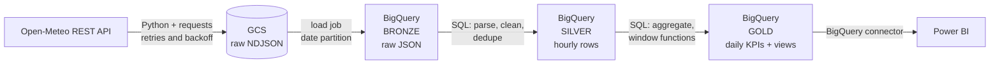

# Weather Data Pipeline: API → GCS → BigQuery → Power BI

An end-to-end ELT pipeline on Google Cloud. It pulls hourly weather data for 8 cities from a public REST API, lands the raw JSON in Cloud Storage, and uses BigQuery SQL to build bronze, silver and gold layers that feed a Power BI dashboard.

## Architecture



| Layer | Table | Contents |
|---|---|---|
| Raw (GCS) | `gs://<bucket>/weather/run_date=YYYY-MM-DD/*.ndjson` | Untouched API responses, one line per city |
| Bronze | `weather_bronze.weather_raw` | Raw JSON string per city per day, partitioned by `run_date` |
| Silver | `weather_silver.weather_hourly` | One clean row per city per hour, typed, validated, de-duplicated; partitioned by date, clustered by city |
| Gold | `weather_gold.daily_city_weather`, `v_weather_report` | Daily KPIs per city plus 7-day rolling average and day-over-day change |

## Design decisions

- **ELT, not ETL.** Raw data is loaded first and transformed inside BigQuery, so logic can be fixed and reprocessed without calling the API again.
- **Raw JSON kept in bronze.** A schema change at the source cannot break the load; parsing happens in silver with `JSON_VALUE_ARRAY` and `UNNEST ... WITH OFFSET`.
- **Idempotent by date.** GCS files are overwritten, bronze loads replace one partition (`table$YYYYMMDD` with `WRITE_TRUNCATE`), silver and gold use delete-then-insert for the date. Re-runs and backfills never create duplicates.
- **Data quality.** Bronze row-count reconciliation (one row per city), silver range checks and `ROW_NUMBER()` de-duplication, and a post-load check expecting 24 hourly rows per city.
- **Resilience.** Exponential backoff on API errors and rate limits, 3 retries per step, failure log, optional Slack/Teams webhook alert and a non-zero exit code for schedulers.
- **Cost control.** Date partitioning, clustering by city, 90-day lifecycle rule on raw files.

## Project structure

```
├── api_to_gcs.py              # API -> GCS (raw NDJSON)
├── gcs_to_bigquery.py         # GCS -> BigQuery bronze + reconciliation
├── transform_bigquery.py      # runs silver/gold SQL + quality gate
├── run_pipeline.py            # orchestrator: retries, backfill, alerts
├── export_powerbi.py          # optional CSV export
├── setup_gcp.py               # one-time bucket + dataset creation
├── config.py
├── sql/
│   ├── silver_weather_hourly.sql
│   ├── gold_daily_city_weather.sql
│   └── gold_views.sql
├── requirements.txt
└── .env.example
```

## How to run

**Prerequisites:** Python 3.10+, Google Cloud CLI, a GCP project with billing enabled (BigQuery's free sandbox does not allow DML).

```bash
python -m venv .venv
.venv\Scripts\activate            # macOS/Linux: source .venv/bin/activate
pip install -r requirements.txt

cp .env.example .env              # Windows: copy .env.example .env, then set GCP_PROJECT_ID
gcloud auth application-default login
python setup_gcp.py               # creates bucket + 3 datasets
```

Run one stage at a time:

```bash
python api_to_gcs.py --date 2026-10-30
python gcs_to_bigquery.py --date 2026-10-30
python transform_bigquery.py --date 2026-10-30
```

Or run everything:

```bash
python run_pipeline.py                                                      # yesterday
python run_pipeline.py --backfill-start 2026-10-01 --backfill-end 2026-10-31
```

## Example query

```sql
SELECT obs_date, city, avg_temp_c, total_precip_mm, comfort_category, temp_7d_avg_c
FROM `YOUR_PROJECT.weather_gold.v_weather_report`
ORDER BY obs_date DESC, avg_temp_c DESC;
```

## Power BI

Get Data → Google BigQuery → `weather_gold` → `v_weather_report`. Suggested visuals: line chart of average temperature by date and city, map or bar chart by city, card for total rainfall, slicers for date and comfort category.

## Possible improvements

- Orchestrate with Airflow / Cloud Composer instead of a script
- Move transformations to dbt with tests
- Provision infrastructure with Terraform
- CI checks (linting, SQL validation) with GitHub Actions
- Freshness monitoring and alerting in Cloud Monitoring

## Data source

[Open-Meteo](https://open-meteo.com/): free weather API, no key required.
